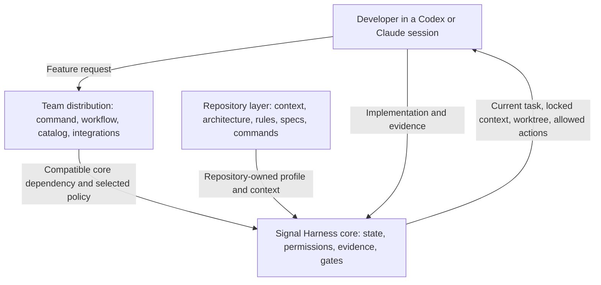
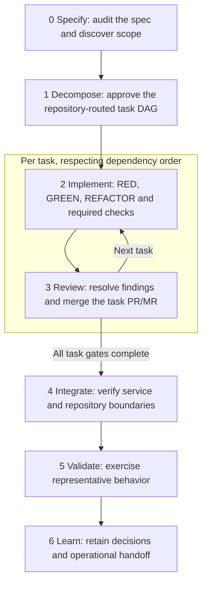

# SDD architecture

Signal Harness supplies the runtime for spec-driven development (SDD): a feature
moves from specification through planning, implementation, review, integration,
validation, and retained knowledge. A Codex or Claude session performs the
engineering work; the core engine tracks state and enforces repository
permissions, evidence requirements, and stage transitions.

Start here for the SDD lifecycle. The [overall architecture](../docs/architecture.md)
covers the shared runtime and the broader authoring, assurance, and learning
boundaries. This release implements SDD and assurance interfaces; the separate
AIAL implementation is planned.

The implementation is grouped under [`signal_harness.sdd`](../src/signal_harness/sdd/).
Reusable infrastructure lives under [`signal_harness.runtime`](../src/signal_harness/runtime/),
which has no dependency on SDD stages or evidence validators. SDD run state
extends the shared persistence store; repository profile types and engineering
signals are reusable without loading the SDD engine. Existing flat Python module
paths remain compatibility imports of the same implementation objects.

SDD tests and fixtures live under [`tests/sdd/`](../tests/sdd/), templates under
[`templates/sdd/`](../templates/sdd/), and schemas under
[`schemas/sdd/`](../schemas/sdd/). Legacy template/schema paths remain validated
compatibility copies for existing consumers. The public authoring plugin keeps
its existing installation path.

## Who owns what

The architecture separates a reusable engine from team policy and repository
knowledge:



| Layer | Owns | Key files |
| --- | --- | --- |
| Core engine | Workflow loading, context locking, task routing, permissions, worktree isolation, evidence validation, state, and PR/MR provider handling. | [`src/signal_harness/`](../src/signal_harness/), [`schemas/`](../schemas/), and the [shared authoring skill](../plugins/signal-harness/skills/signal-harness/SKILL.md). |
| Team distribution | The installed workflow, repository catalog, team-wide instructions, integrations, compatible core version, and stable end-user command. | Consumer-owned `distribution.yaml`, policy `sdd.yaml`, catalog, and command/agent adapters. See the [distribution manifest fixture](../tests/sdd/fixtures/distribution/distribution.yaml) and [policy templates](../templates/sdd/policy-pack/). |
| Repository | Service architecture, brownfield rules, specifications, context selection, and build/test commands. | Consumer-owned `.signal-harness/repo.yaml` and the files it references. See the [repository profile template](../templates/sdd/repository/repo.yaml). |

In a **three-tier deployment**, each service owns its repository layer and the
team maintains a separate distribution. In a **two-tier deployment**, one
consumer owns its policy, repository configuration, and user entrypoint together.
Both consume the same core engine. See the [consumption models](../README.md#choose-a-consumption-model).

Feature developers use their distribution's command or agent entrypoint.
Distribution authors use the core CLI to build and validate that integration.

## The seven stages

The [reference workflow](../templates/sdd/policy-pack/sdd.yaml) defines the stages
below. Stages 0, 1, 4, 5, and 6 operate at feature scope; Stages 2 and 3 repeat
for each routed task, respecting task dependencies.



| Stage | Engineering work and deliverables | Reference gate |
| --- | --- | --- |
| **0 — Specify** | Audit the specification and its sources. Resolve questions about behavior, errors, compatibility, rollout, affected callers, and ownership. Inspect current source to identify affected delivery surfaces and relevant repositories; lock the supporting evidence. Record source/delegation, caller, surface, precedent, and preflight audits as required by policy. | Approved and merged specification PR/MR, with structured `specification` evidence. Unresolved delegation cannot pass. |
| **1 — Decompose** | Produce a directed acyclic graph (DAG) of tasks. Give each task a repository owner, source-backed ownership evidence, task-scoped context, ordered test cases, required checks, and dependencies. Close discovered surfaces and callers through tasks or evidenced decisions. Declare cross-repository artifact dependencies. | Approved and merged task-plan PR/MR, with `task-plan` evidence. Only then does the runtime materialize executable tasks and grant authorized implementation scope. |
| **2 — Implement** | Read and acknowledge locked task context, prepare an isolated worktree, and implement in the assigned repository. Record ordered RED/GREEN/REFACTOR evidence and run repository-owned verification commands. | Automatic `tdd` gate, including the latest passing engine-produced signals for required checks. |
| **3 — Review** | Reconcile implementation against task criteria, callers, and affected surfaces. Resolve review findings, rerun affected verification, record the privacy check, and satisfy configured review dimensions. Publish the task branch and open its routed PR/MR. | Approved and merged task PR/MR, with structured `review` evidence. |
| **4 — Integrate** | Verify the affected repository and service boundaries using declared integration and compatibility checks. Preserve the results and integration assessment. | Human sign-off with `integration` evidence. |
| **5 — Validate** | Exercise representative happy paths, failure paths, and rollout behavior in a suitable environment. Preserve smoke-test and rollout evidence. | Human sign-off with `smoke` evidence. |
| **6 — Learn** | Persist reusable decisions, architecture updates, learning candidates, and follow-up work. Multi-repository task ownership also requires a rollback owner, unwind order, deployment order, and alerting procedure. | Automatic `knowledge` gate requiring the relevant signals and persisted artifact references. |

**Stage 0 includes specification review and clarification.** Stage 1 decomposes
the reviewed specification into implementation work.

The gate kinds in the table describe the neutral template. At runtime, the
selected distribution's YAML is authoritative for its activities, supported
gates, evidence types, and additional requirements. The core validates that
policy through [`workflow.py`](../src/signal_harness/sdd/workflow.py) and enforces
its evidence contracts through [`lifecycle.py`](../src/signal_harness/sdd/lifecycle.py)
and [`state.py`](../src/signal_harness/sdd/state.py).

## How the layers execute a feature

1. **Distribution:** The developer invokes the team's command from an onboarded
   repository. The adapter selects its distribution manifest, catalog, workflow,
   and compatible core. For example, the scaffolded wrapper supports
   `acme-sdd start audit-export`.
2. **Core + repository:** The core resolves the sponsor repository, reads its
   declared context and feature information, and locks source identity. Starting
   discovery creates no executable implementation tasks.
3. **Session + core, Stage 0:** The session audits the specification and searches
   the sponsor's source. Locked evidence justifies engaging another catalog
   repository; its exact relevant source paths can then be locked as well.
4. **Session + distribution policy, Stage 1:** The session proposes the task DAG
   under the team's policy. The core checks coverage, ownership, dependencies,
   required checks, and gate evidence before materializing tasks.
5. **Session + repository, Stages 2–3:** The session acknowledges task context and
   works in the prepared repository worktree. The core executes declared checks,
   stores evidence, and enforces each task's route. The session commits changes;
   core publication commands push and open the PR/MR in the assigned repository.
6. **Core + hosting provider:** Resume refreshes external PR/MR state. A PR gate
   advances only with the required approval, merge, and stage evidence. Dependent
   tasks also wait for required producer artifact provenance.
7. **Session + human reviewers, Stages 4–6:** The team completes integration and
   environment validation, then preserves knowledge and operational handoff.
   The core validates the corresponding evidence and records completion.

The engine supplies the session protocol and enforcement. The coding session
performs source analysis and authoring; human reviewers assess decisions and
results. Passing structured evidence checks alone does not establish semantic
correctness.

For distribution development, the underlying start and handoff commands are:

```shell
signal-harness sdd audit-export --distribution acme-sdd --start --run-id audit-export-run
signal-harness next audit-export-run
```

`acme-sdd` is an example registered distribution name. The
[operations guide](../docs/operations.md) documents the command protocol, and
the [authoring skill](../plugins/signal-harness/skills/signal-harness/SKILL.md)
gives the session its detailed execution instructions.

## Discovery and cross-repository boundaries

- A catalog defines the authorized candidate repositories and explicit `author`
  permission. Membership does not trigger a clone or context read of every repo.
- Discovery starts with the sponsor. The session uses current source evidence to
  engage relevant peers incrementally. Required access failures stop that work
  with actionable access handling; excluded repositories stay outside the run.
- APIs, events, schemas, generated clients, and configuration interactions are
  discovered per feature. Teams maintain a lightweight repository catalog rather
  than a static inventory of every service contract.
- A context-only repository can inform a task without receiving code changes.
  A repository may own implementation only when explicitly authorized and
  equipped with an onboarded profile and verification commands. Profileless
  peers remain discovery-only.
- A task's repository determines its worktree, branch, checks, and PR/MR target.
  Cross-repository dependencies carry immutable artifact identity, digest,
  producer revision, and provider provenance before consumer preparation.

## Evidence, recovery, and completion

Run state and its audit journal live outside participant repositories, under
`$XDG_STATE_HOME/signal-harness/<run-id>/` or
`~/.local/state/signal-harness/<run-id>/`. Specifications, task plans, code, and
retained knowledge remain reviewable artifacts in their owning repositories.
The policy selects evidence contracts; it does not mandate one universal set of
Markdown filenames for every consumer.

The runtime supports audited recovery paths: Stage 2→0 for clarification,
Stage 2→1 for re-decomposition, and Stage 3→2 for review fixes. Clarification
returns to the interrupted task after the revised specification clears;
re-decomposition invalidates the old task graph before a replacement is
materialized. Use runtime commands to perform those transitions.

Production mode rejects waivers and local-only PR or artifact evidence.
Evaluation mode permits only explicitly waivable gates and records waivers
separately from passing results. PR gates cannot be waived. A waived run ends as
`evaluation-complete-with-waivers`, not a production pass. See
[security](../docs/security.md) for command authorization, credential handling,
provider data flow, and local-artifact sensitivity.

## Implementation map and adoption

| Concern | Implementation or documentation |
| --- | --- |
| Workflow stages, gates, and requirement options | [Reference YAML](../templates/sdd/policy-pack/sdd.yaml), [workflow schema](../schemas/sdd/workflow.schema.json), [`workflow.py`](../src/signal_harness/sdd/workflow.py). |
| Distribution compatibility and policy loading | [`distributions.py`](../src/signal_harness/sdd/distributions.py), [`catalog.py`](../src/signal_harness/sdd/catalog.py), [SDD discovery entrypoint](../src/signal_harness/sdd/__init__.py). |
| Context discovery and immutable evidence | [`context.py`](../src/signal_harness/runtime/context.py), [`git.py`](../src/signal_harness/runtime/git.py), [`session.py`](../src/signal_harness/sdd/session.py). |
| Task routing, worktrees, and artifact dependencies | [`planner.py`](../src/signal_harness/sdd/planner.py), [`worktrees.py`](../src/signal_harness/sdd/worktrees.py), [`artifact_handoff.py`](../src/signal_harness/sdd/artifact_handoff.py). |
| TDD, command signals, gate validation, and recovery | [`tdd.py`](../src/signal_harness/sdd/tdd.py), [`verification.py`](../src/signal_harness/sdd/verification.py), [`lifecycle.py`](../src/signal_harness/sdd/lifecycle.py), [`state.py`](../src/signal_harness/sdd/state.py), [`control.py`](../src/signal_harness/sdd/control.py). |
| PR/MR publication and external review state | [`hosting.py`](../src/signal_harness/sdd/hosting.py), [`forge.py`](../src/signal_harness/runtime/forge.py), [GitHub/GitLab provider guide](../docs/forge-providers.md). |
| Team integrations and durable provider events | [`integrations.py`](../src/signal_harness/runtime/integrations.py), [operations](../docs/operations.md). |

To adopt the engine, start with the root README's
[distribution setup](../README.md#distribution-owners-onboard-to-the-engine)
and [repository onboarding](../README.md#repository-owners-add-the-repository-layer).
The `init distribution`, `init repository`, and `init standalone` commands
provide starting materials for the chosen ownership model. Repository owners
review detected context and commands before use. Consume an immutable `sdd-v*`
release and validate upgrades against the distribution's compatibility tests;
see [component releases](../docs/release.md).
